# About this manual

GoalNexa tracks goals by numbers. A **goal** ("Launch v2 of the mobile
app") is measured by one or more **metrics** ("Beta testers: 0 → 500
users"), and you record progress with **check-ins** ("we're at 380").
GoalNexa turns the check-ins into progress, a prediction for the target
date and a health badge, alone or with your team.

The manual follows what you do, in order:

| Chapter | You learn to |
|---|---|
| 1. Getting started | Sign up, sign in, use the onboarding wizard |
| 2. Finding your way | The sidebar, the user menu, organizations |
| 3. The dashboard | Read progress, predictions and health |
| 4. Goals and metrics | Create goals, metrics, sub-goals |
| 5. Checking in | Record progress, one at a time or many at once |
| 6. Reminders and digest | Get nudged when a check-in is due |
| 7. Working with a team | Organizations, invitations, sharing, comments |
| 8. Cycles | Plan by quarter, close and score |
| 9. Teams and the team board | One goal system across many teams |
| 10. Sharing a dashboard | A read-only link for anyone |
| 11. AI assistants | Plan and check in by chat |
| 12. Automatic check-ins | Feed a metric from another system |
| 13. Your account | Password, data export, email preferences |
| 14. Administration | The system console (administrators) |
| Appendix | Field reference, glossary, troubleshooting |

Screen-by-screen functions are listed in *GoalNexa functions by
screen* (`docs/user-guide/03-functions-by-screen.md`). Numbers in red
circles on the screenshots match the numbered steps next to them.


# 1. Getting started

## 1.1 Create an account

1. Open your GoalNexa address (for example `https://goals.example.com`).
2. Click **Sign up** under the sign-in box.
3. Enter your **Name**, **Email** and a **Password** (at least 8
   characters).
4. Click **Sign Up**.

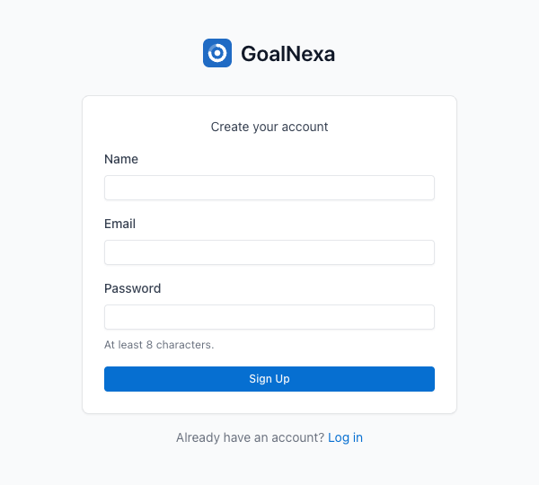{width=60%}

- If your administrator requires confirmed email addresses, GoalNexa
  shows "We sent a link to \<your email\>". Open the email and click the
  link (it works for 7 days). **Send it again** sends a new one.
- If sign-up is closed or by invitation only, use the link from your
  invitation (see 7.3) or ask your administrator.

> **First install?** On a brand-new GoalNexa there are no accounts. The
> site opens **Welcome - let's set things up** instead: the account you
> create there becomes the administrator.

## 1.2 Sign in

1. Enter your **Email** and **Password**.
2. Click **Sign In**.

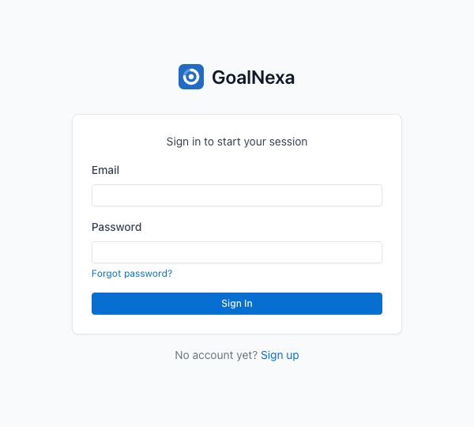{width=60%}

If your company uses single sign-on, click **Continue with \<provider\>**
instead. After several wrong passwords in a row the account is locked
for a few minutes; a password reset or an administrator unlocks it.

## 1.3 Forgot your password

1. On the sign-in page click **Forgot password?**
2. Enter your **Email** and click **Email me a link**.
3. Open the email, click the link (valid 2 hours), enter the **New
   password** twice and click **Save password and sign in**.

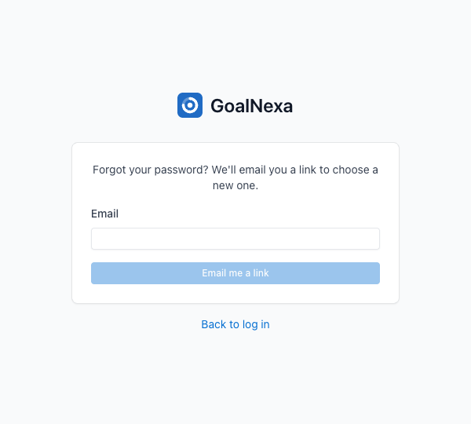{width=60%}

## 1.4 The onboarding wizard

The first time you open GoalNexa with no goals, the dashboard shows a
short wizard.

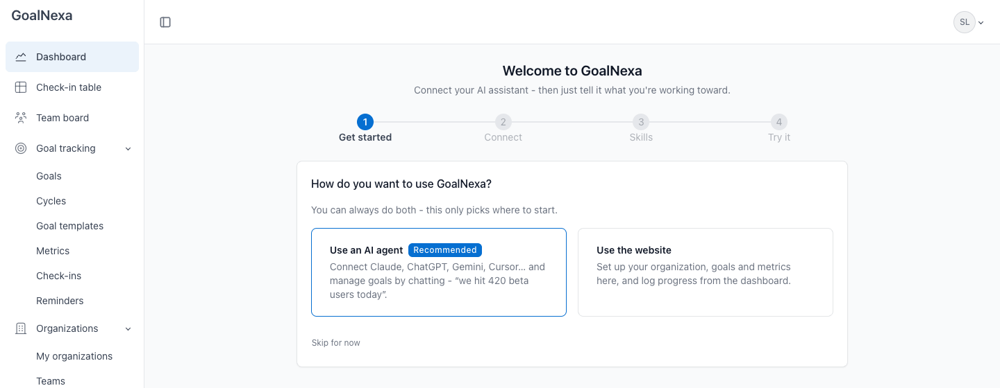

**Step 1 - choose how to start.**

- **Use an AI agent** (recommended): connect Claude, ChatGPT, Cursor and
  others, then manage goals by chatting. See chapter 11.
- **Use the website**: set up everything on this page.
- **Skip for now**: go straight to an empty dashboard. You are not asked
  again in this browser.

### Website path

1. **Name your organization** - your team, company or household. Goals
   belong to it and you can invite others later. Click **Next**.

   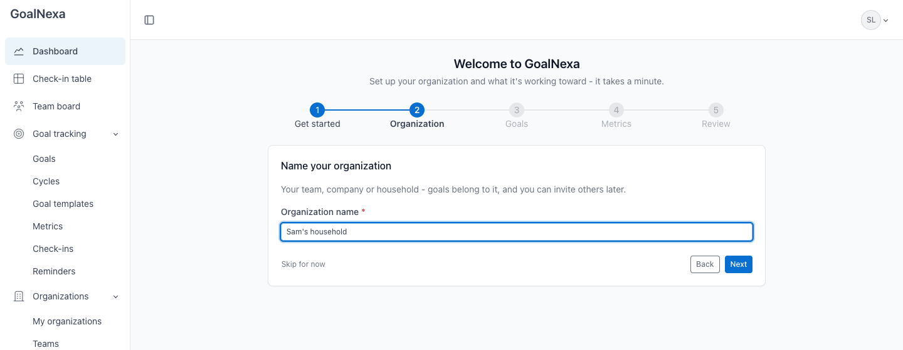

2. **What are you aiming for?** - type a **Goal** and, optionally, a
   **Target date** (it lets the dashboard predict whether you'll make
   it). **+ Add goal** for more. Click **Next**.

   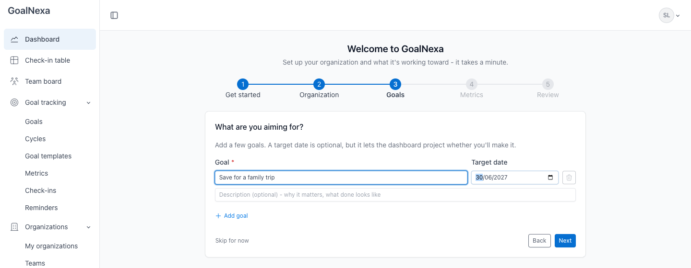

3. **How will you measure each goal?** - for each goal add a metric:
   name, unit, **start** and **target** (the target must differ from the
   start; it may be lower, for something that should go down). Click
   **Next**.

   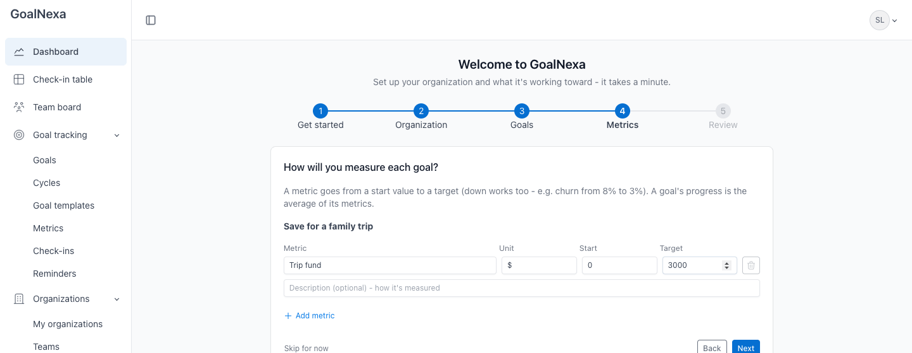

4. **Ready to go** - check the summary and click **Create and open
   dashboard**.

   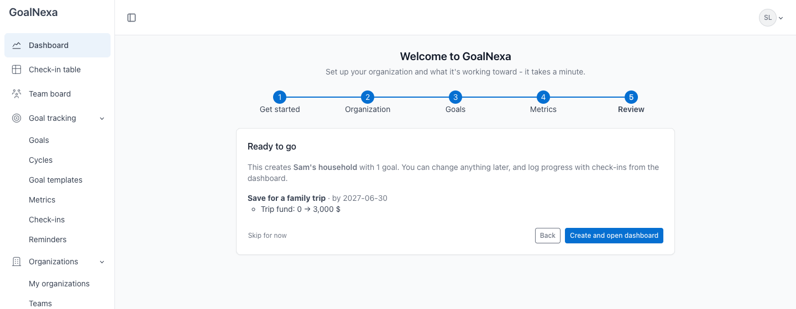

Nothing is saved before the last step. If something fails, fix it and
click again - what was already created is kept, not duplicated.

### AI-agent path

1. **Connect your AI assistant** - pick the app you use and follow its
   steps (details in chapter 11). The wizard shows **Connected** once the
   app reaches GoalNexa.
2. **Teach it GoalNexa** - copy the "Install the goalnexa skills from
   ..." prompt into your assistant (not needed for a Claude connector).
3. **Tell it what you're working toward** - copy a starter prompt (plan,
   check in, review) and click **Done - open dashboard**.

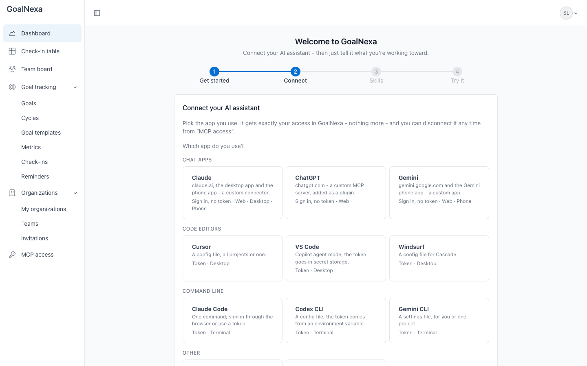


# 2. Finding your way

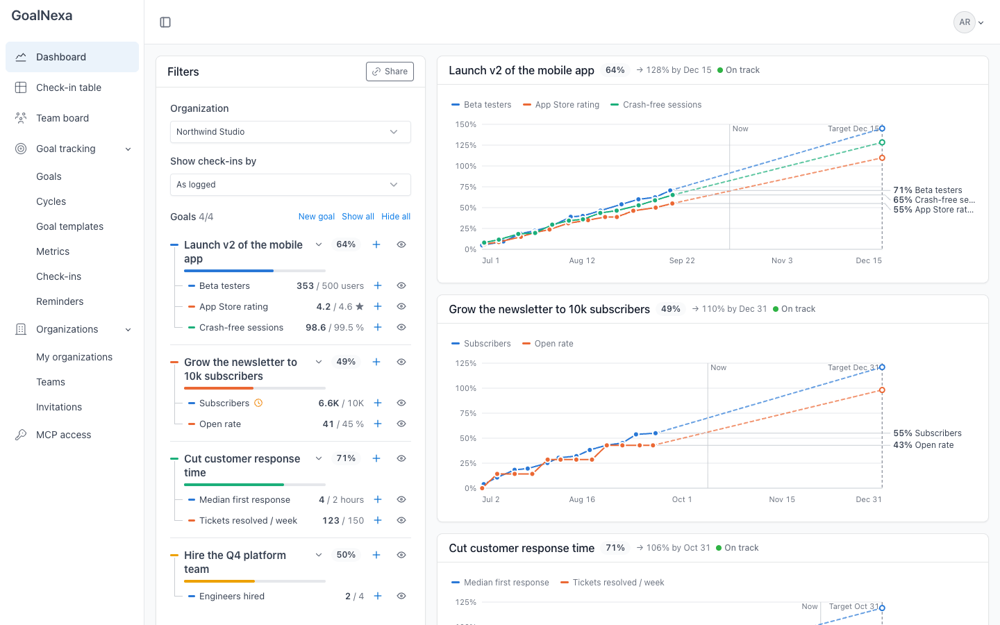

## 2.1 The sidebar

| Entry | What it opens |
|---|---|
| **Dashboard** | Charts of your goals (chapter 3) |
| **Check-in table** | All metrics and their history as a spreadsheet (5.4) |
| **Team board** | One goal template across teams (chapter 9) |
| **Goal tracking** | Lists of Goals, Cycles, Goal templates, Metrics, Check-ins; **Reminders** |
| **Organizations** | My organizations, Teams, Invitations |
| **MCP access** | Connect an AI assistant (chapter 11) |

Click a group name to fold it; the icon at the top left of the header
hides the whole sidebar. Pages you have no permission for are not
shown.

## 2.2 The user menu

Click your initials at the top right.

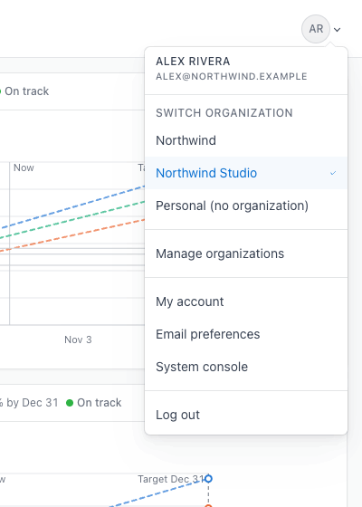{width=45%}

- **Switch organization** - choose the organization (or *Personal (no
  organization)*) the dashboard and check-in table show.
- **Manage organizations** - your organizations' pages.
- **My account** - password, data export, delete account (chapter 13).
- **Email preferences** - which emails you get.
- **System console** - administrators only (chapter 14).
- **Log out**.

## 2.3 Personal goals and organizations

- A **personal** goal (no organization) is visible only to you.
- An **organization** goal is shared with the organization's members
  (unless you make it private, see 7.4).
- You can belong to several organizations and switch between them at
  any time.


# 3. The dashboard

The dashboard is the main screen: pick goals on the left, read their
charts on the right.

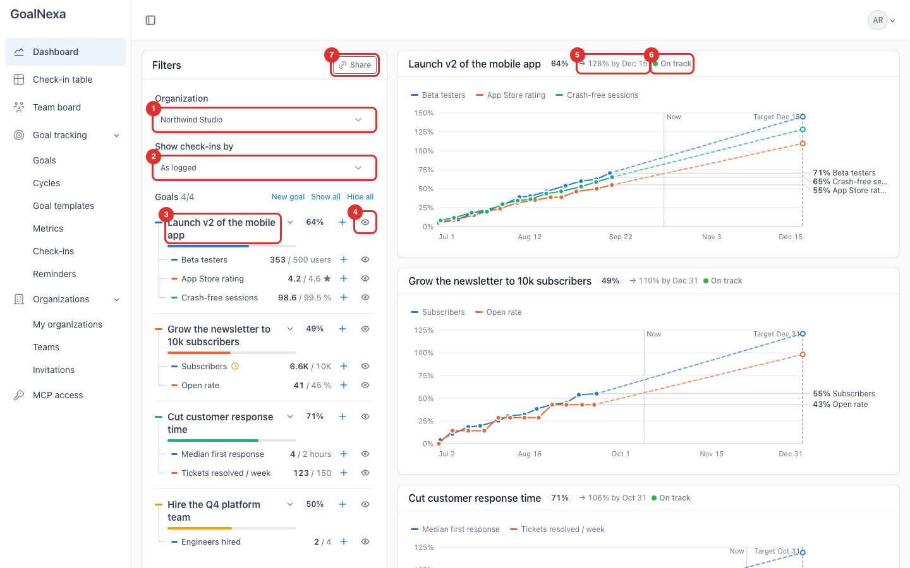

1. **Organization** - whose goals to show.
2. **Show check-ins by** - *As logged*, or one value per Day / Week /
   Month / Quarter / Year (amounts also appear as bars).
3. **Goal** - click the title to open its details in a side panel.
4. **Eye** - show or hide the goal in the charts (up to 8 at a time).
5. **Prediction** - where the goal is heading by its target date.
6. **Health** - *On track*, *At risk*, *Off track* or *Achieved*.
7. **Share** - a read-only link (chapter 10).

When the organization has cycles or teams, **Cycle** and **Team**
filters appear too. The dashboard opens on the cycle running today.

## 3.1 The goal tree

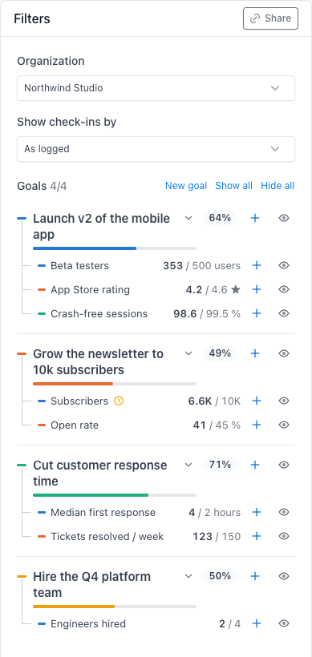{width=55%}

Each goal shows its color, title, current % and a progress bar.
Under it are its **metrics** (current / target and unit), then its
**sub-goals**.

- **Eye on a goal** shows/hides it in the charts. **Show all**, **Show
  first 8** and **Hide all** act on every goal. Hiding a goal hides its
  sub-goals.
- **Eye on a metric** leaves that metric out of the goal's progress
  (the row stays, dimmed).
- **Arrow** next to a title folds the row.
- **Drag** a row up or down to reorder it among its siblings.
- **+** opens a menu: on a goal **Add metric / Add sub-goal**, on a
  metric **Check in / Add sub-metric**.
- A **clock** after a metric's name means its scheduled check-in is
  overdue; click it to check in.
- Archived goals are not listed.

## 3.2 Reading a goal's chart

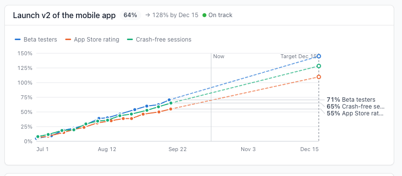

- Each line is one metric's progress in % (from its start to its
  target). The color matches the metric's key in the tree.
- **Now** is today; **Target \<date\>** is the goal's target date.
- The **dashed line** ending in a hollow dot is the **prediction**: each
  metric's trend carried forward to the target date.
- The header shows the goal's %, "→ N% by \<date\>" (the predicted
  progress) and the health badge.
- Hover a point to see the metric's % and its actual reading
  ("353 / 500 users"), who checked in and from where.
- A metric whose target equals its start is **tracked only**: it gets its
  own small value chart under "Tracked, no target" and doesn't count in
  the %.
- A metric with a target per period (a quota) adds a **Per period** bar
  chart (see 4.5).

## 3.3 How progress and health are calculated

- **Metric progress** = (current - start) / (target - start). A target
  below the start works for things that should go down.
- **Goal progress** = the average of its top-level metrics. Sub-metrics
  break a metric down and do not count.
- **Health**, from the prediction at the target date:

| Badge | Meaning |
|---|---|
| **Achieved** | The goal is at 100% |
| **On track** | Predicted to reach 100% by the target date |
| **At risk** | Predicted 80-99% |
| **Off track** | Predicted below 80%, or the target date has passed |
| *(none)* | No target date or no check-ins yet |
| **Tracking** | No metric has a target - just readings |


# 4. Goals and metrics

## 4.1 Create a goal

1. On the dashboard click **New goal** in the Goals header.

   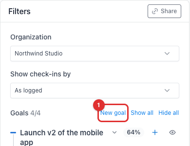{width=55%}

2. Fill in the form. Only **Title** is required.

   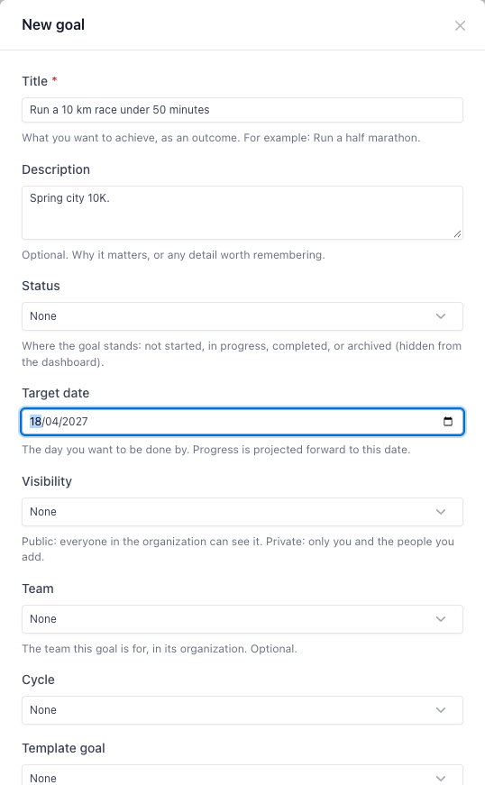{width=45%}

   - **Title** - the outcome, e.g. "Run a 10 km race under 50 minutes".
   - **Description** - why it matters.
   - **Status** - Not started / In progress / Completed / Archived
     (archived goals leave the dashboard).
   - **Target date** - enables the prediction and health.
   - **Visibility** - Public (whole organization) or Private (you and
     the people you add); *Team* for a team's goal.
   - **Team**, **Cycle** - optional; preset from the dashboard filters.
3. Click **Create**. The goal appears in the tree.

You can also create goals from **Goal tracking > Goals > + New goal**.

## 4.2 Add a metric

1. Click **+** on the goal's row and choose **Add metric**.

   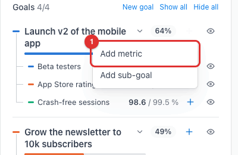{width=55%}

2. Fill in the metric:

   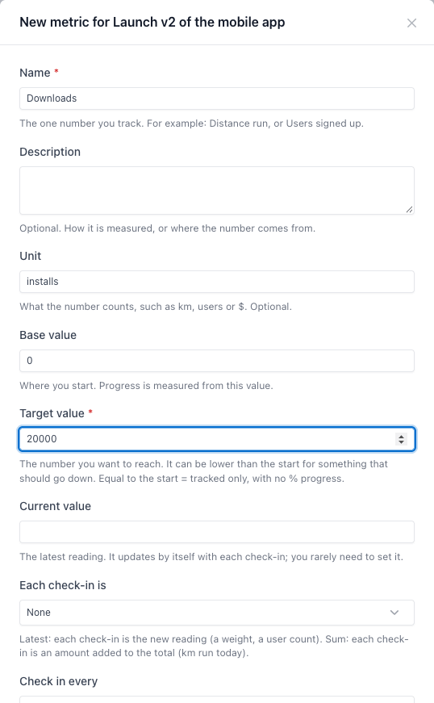{width=45%}

   - **Name** - the one number you track ("Downloads").
   - **Unit** - km, users, $, % ...
   - **Base value** - where you start.
   - **Target value** - where you want to be. Lower than the base for
     something that should go down. Equal to the base = tracked only.
   - **Current value** - leave blank; check-ins update it.
   - **Each check-in is** - *The new value (a reading)* for things like
     a user count or a weight; *An amount to add to the total* for
     things like "ran 5 km".
3. Optional settings further down:

   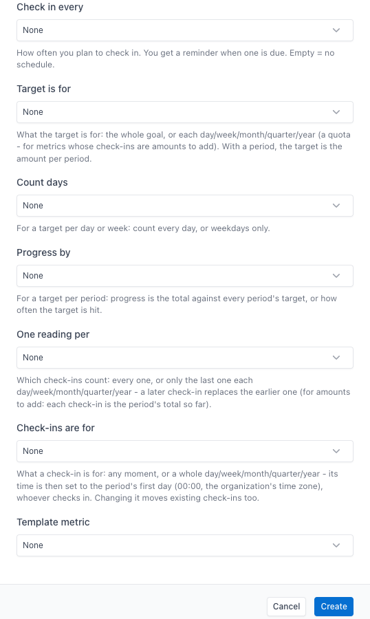{width=45%}

   - **Check in every** - Daily / Weekly / Monthly: you get a reminder
     when a check-in is due (chapter 6).
   - **Target is for**, **Count days**, **Progress by**, **One reading
     per**, **Check-ins are for** - quotas per period (4.5).
4. Click **Create**.

## 4.3 Sub-goals and sub-metrics

- **Sub-goal**: on a goal's **+** choose **Add sub-goal**. It is a goal of
  its own, nested under its parent in the tree, with its own metrics.
- **Sub-metric**: on a metric's **+** choose **Add sub-metric** to break
  a number into parts (e.g. Revenue → Revenue EU, Revenue US). Sub-metrics
  don't count toward the goal's progress - the parent does.

## 4.4 Edit, archive or delete

1. Click the goal's or metric's name in the tree. A side panel opens.

   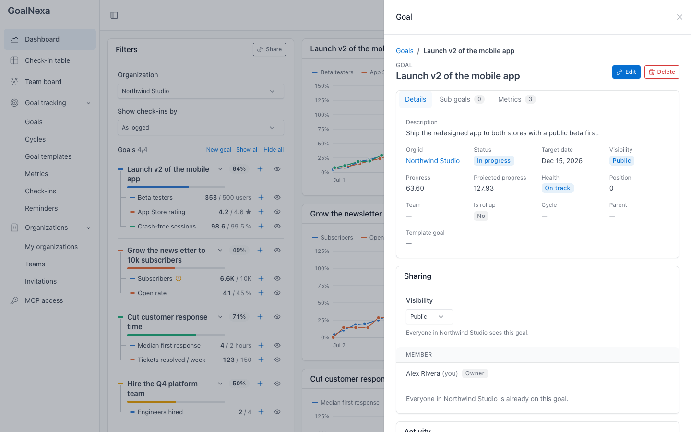

2. Click **Edit**, change the fields and click **Save** - or **Delete**.
3. To finish a goal without deleting it, set **Status** to *Completed*
   or *Archived*.
4. Close the panel (×); the charts refresh.

The same pages are under **Goal tracking > Goals / Metrics**, with
**Details** and tabs for related items (a goal's **Metrics** and **Sub
goals**, a metric's **Check ins**).

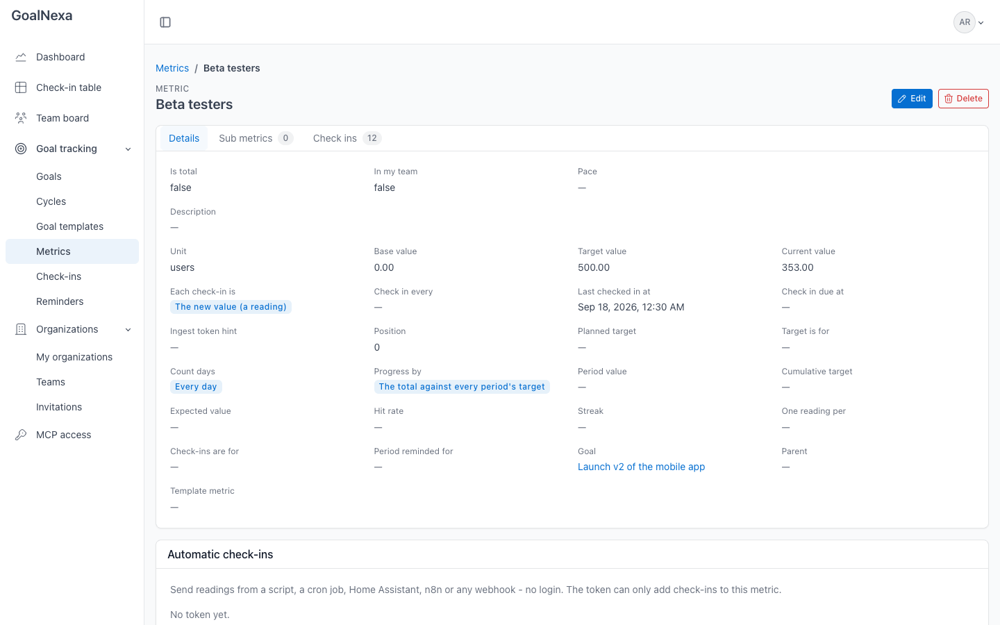

## 4.5 Quotas: a target per day, week or month

For habits and recurring targets ("10 demos per week", "8,000 steps a
day") use a metric whose check-ins are **amounts to add**, then set:

| Field | Choose |
|---|---|
| **Target is for** | Each day / week / month / quarter / year (the target becomes the amount per period) |
| **Count days** | Every day, or Weekdays only (for daily/weekly targets) |
| **Progress by** | *The total against every period's target*, or *How often the target is hit* (hit rate) |
| **One reading per** | Only the last check-in of each period counts (send "the total so far today") |
| **Check-ins are for** | A check-in counts for a whole day/week/month - its time is set to the period's start |

The tree then shows "done / quota /wk", the chart adds **Per period**
bars, and the metric's page shows the **hit rate** and **streak**.

## 4.6 Lists, search and filters

Every list page (Goals, Metrics, Check-ins, Cycles...) works the same:

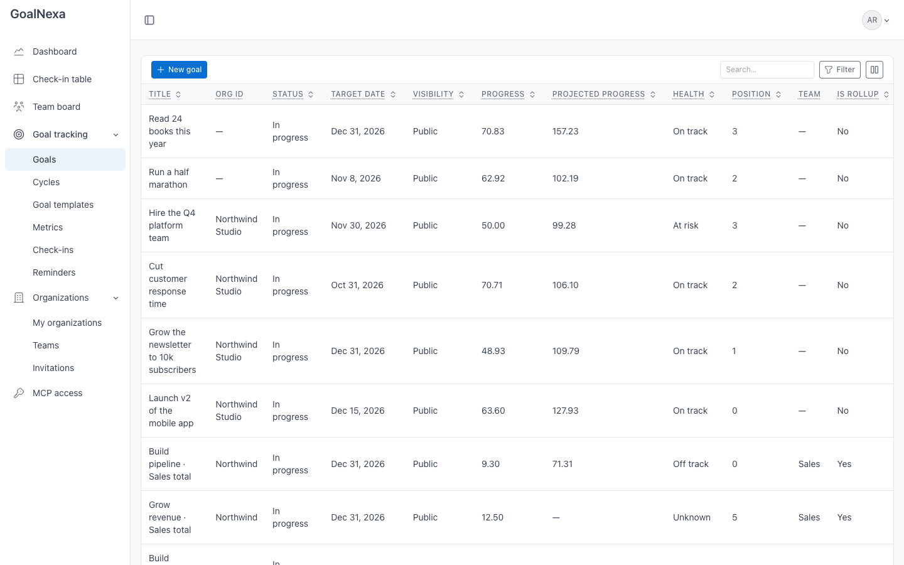

- **+ New ...** creates an item.
- **Search…** finds by name.
- **Filter** → **+ Add filter…** → pick a field, an operator (contains,
  is, >, before, is empty...) and a value → **Apply**. Filters show as
  chips; × removes one, **Clear** removes all.
- The **columns** button shows, hides and reorders columns.
- Click a row to open it; the eye, pencil and bin icons view, edit and
  delete.

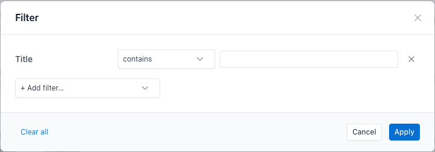{width=65%}


# 5. Checking in

## 5.1 Check in from the dashboard

1. On the metric's row click **+** and choose **Check in**.

   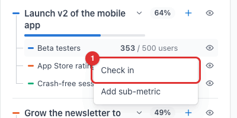{width=55%}

2. Enter the **Value**:
   - a *reading* metric: the new number ("380" beta testers now);
   - a *sum* metric: the amount done ("12" km today) - the form shows
     the new total.
3. Optional: **When** (leave blank for now - set it to backdate), and a
   **Note**.
4. Click **Save check-in**. The charts, %, prediction and health update.

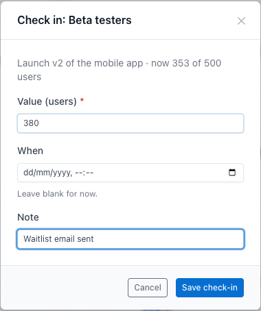{width=55%}

> A backdated check-in is fine: the current value is always the latest
> reading *by date*, not the last one typed.

## 5.2 When a check-in is due

A metric with **Check in every** shows a clock after its name once a
check-in is overdue. Click the clock to open the check-in form.

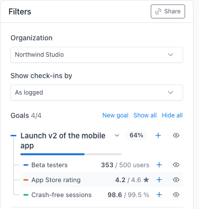{width=55%}

## 5.3 Edit or delete a check-in

Open the metric (click its name) → **Check ins** tab → pencil to edit,
bin to delete. Progress is recalculated.

## 5.4 Many check-ins at once: the check-in table

**Check-in table** shows every goal and metric as rows and their
history as columns - handy for a weekly update.

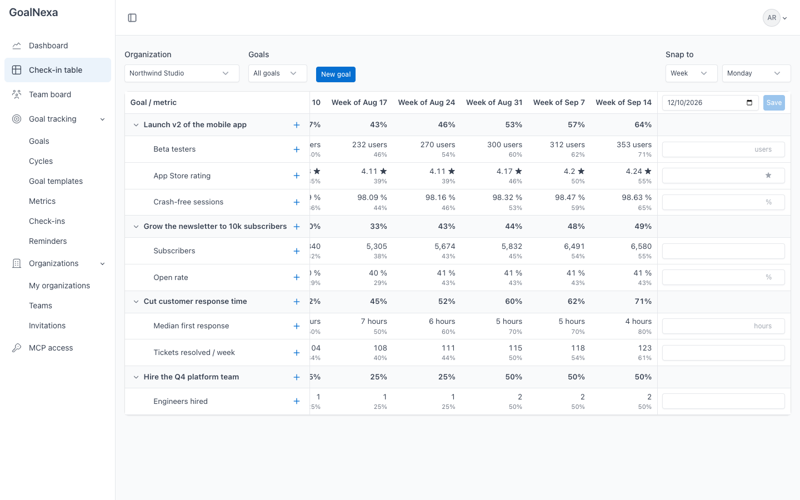

1. Pick the **Organization** and, optionally, tick **Goals** to narrow
   the rows.
2. **Snap to** sets one column per Hour / Day / Week / Month (for weeks,
   pick the first weekday).
3. In the right-hand column choose the period or date, then type a value
   in each metric's box (Enter moves on and saves).
4. Click **Save N**.

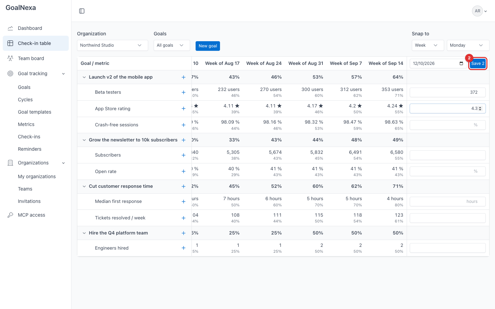

Hover a value to read its notes. The **Target** column shows "start ->
target". Drag a row's name to reorder; **+** has the same menus as on
the dashboard.


# 6. Reminders and the goals digest

1. Give metrics a schedule: **Check in every** = Daily, Weekly or Monthly
   (4.2).
2. Open **Goal tracking > Reminders**.

   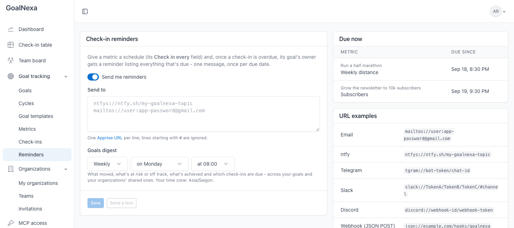

3. Turn on **Send me reminders**.
4. Choose where they go:
   - **Email them to my account address** (if your GoalNexa sends
     email), and/or
   - **Send to**: one address per line in Apprise format - see **URL
     examples** on the right (Telegram `tgram://`, Slack, Discord, ntfy,
     email `mailtos://`...).
5. **Goals digest**: *Weekly* (pick the day) or *Daily*, and the hour
   (in your browser's time zone) - a summary of what moved, what's at
   risk and what's due. *Off* turns it off.
6. Click **Save**, then **Send a test** to check delivery.

How reminders behave:

- One message per goal owner, listing everything that's overdue, once
  per due date - no repeated nagging.
- **Due now** (right) lists overdue metrics. Metrics without a schedule
  are never due.
- For a quota metric you may also get a nudge near the end of a period
  if you're short.


# 7. Working with a team

## 7.1 Create an organization

1. **Organizations > My organizations** → **+ New organization**.
2. Enter the **Name** and, optionally, a **Time zone** (where the
   organization's day starts - daily/weekly targets count in it).
3. Click **Create**.

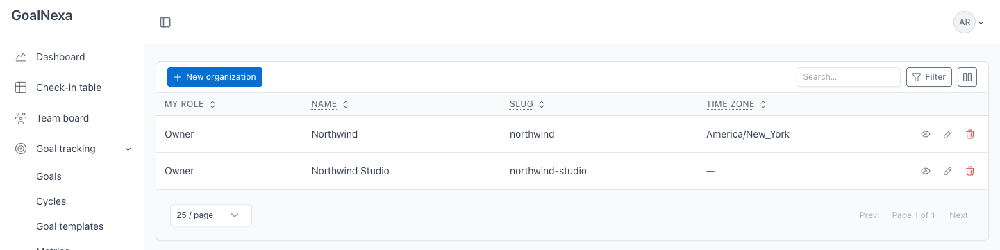

## 7.2 Invite members

1. Open the organization → **Invite member**.

   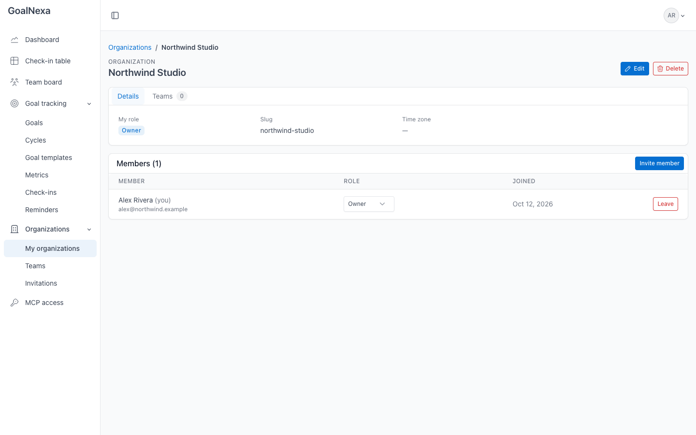

2. Enter their **Email** and **Role**: *Member* (works on the goals) or
   *Admin* (also manages members and invitations). Click **Create
   invitation**.

   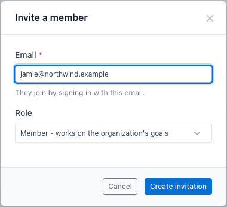{width=55%}

3. GoalNexa does **not** email the invitation. Click **Copy link** and
   send it yourself (chat, email). The link expires after two weeks.

   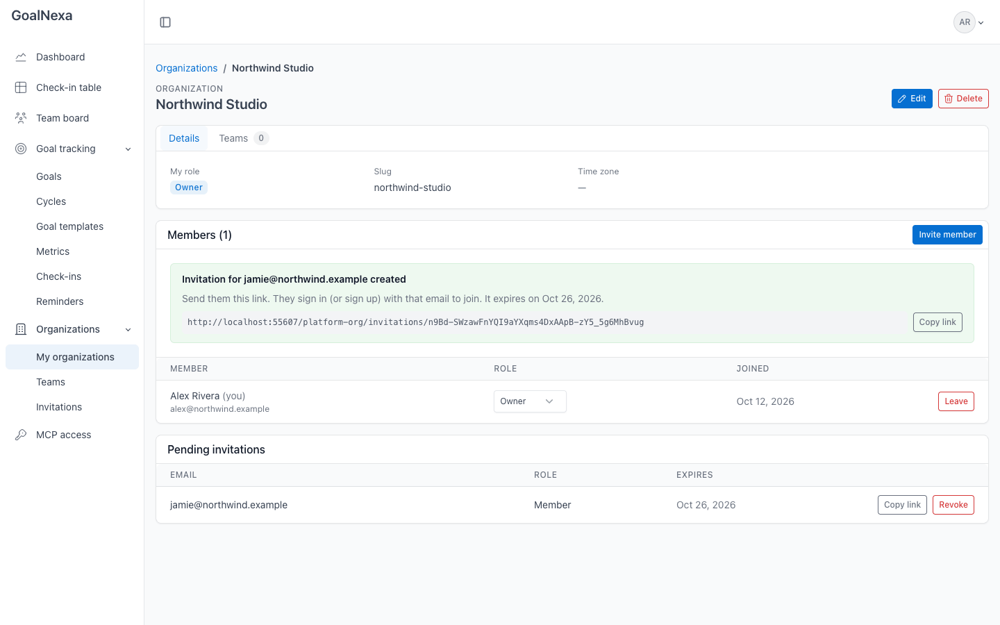

**Pending invitations** lists open invitations: **Copy link** again or
**Revoke**.

## 7.3 Accept an invitation

1. Open the link you received.
2. No account yet? You land on **Sign up** with your email filled in.
   Otherwise sign in with **the same email** the invitation was for.
3. On "Join \<organization\>" click **Accept invitation** (or **Decline**).

Invitations to your email also appear under **Organizations >
Invitations** with **Accept** / **Decline**.

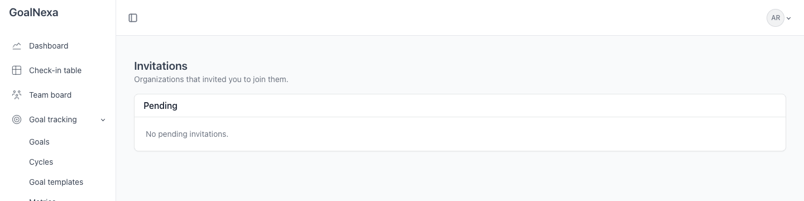

## 7.4 Roles and who sees what

| Role | Can |
|---|---|
| **Owner** | Everything, including changing roles and owners |
| **Admin** | Manage members, invitations, teams and goal templates |
| **Member** | See the organization's public goals; create goals, check in |

- Change a role with the select in the **Members** table; **Remove**
  someone, or **Leave** yourself.
- An organization always keeps an owner.
- Leaving an organization ends your access to its goals - even ones you
  created.

## 7.5 Make a goal private

1. Open the goal (click its name) → **Sharing**.
2. Set **Visibility**: *Public* (everyone in the organization),
   *Private* (only the owner and the members listed), or *Team only*
   (a team's goal).
3. For a private goal, pick someone in **Add a member of \<org\>…** and
   click **Add**. **Remove** takes them off; a member can **Leave**.

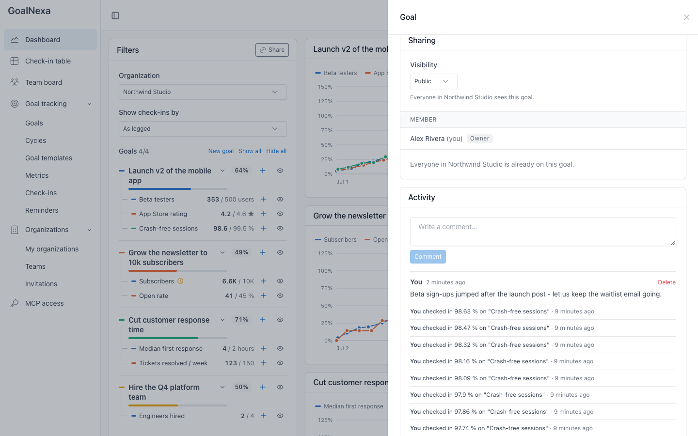

Only the goal's owner can change visibility and members. Metrics and
check-ins follow their goal.

## 7.6 Comments and the activity feed

Under **Activity** on a goal:

- Type in **Write a comment…** and click **Comment**. You can delete your
  own comments.
- The feed lists who created or changed the goal, added metrics, checked
  in (marked *AI agent* when an assistant did it), and when the health
  changed.


# 8. Cycles: plan and score by quarter

A **cycle** is a period - usually a quarter - that goals belong to.

## 8.1 Create a cycle and add goals

1. **Goal tracking > Cycles** → **+ New cycle**.
2. Enter **Name** ("Q1 2027"), **Organization** (empty = personal),
   **Starts on**, **Ends on**, **Status** (*Planning* or *Active*).
3. Click **Create**.
4. Put goals in it: set **Cycle** when creating or editing a goal. On the
   dashboard, pick the cycle in the **Cycle** filter first - **New goal**
   then presets it.

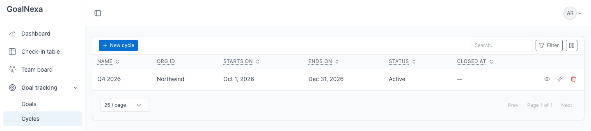

## 8.2 Close a cycle

At the end of the period, open the cycle. The **Close this cycle**
panel lists its goals.

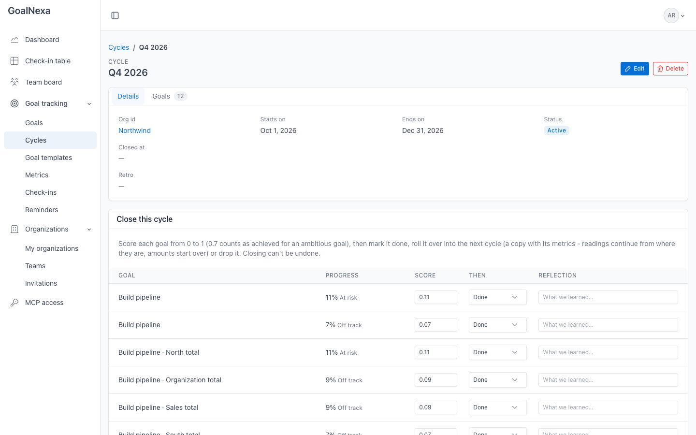

1. For each goal set a **Score** from 0 to 1 (prefilled from its
   progress; 0.7 counts as achieved for an ambitious goal).
2. Choose **Then**: *Done* (completed), *Roll over* (a copy continues in
   the next cycle - readings continue, amounts start over) or *Drop*
   (archived).
3. Optional **Reflection** per goal and a **Retro** for the cycle.
4. If any goal rolls over, pick **Roll over into** - or click **Create
   "\<next quarter\>"**.
5. Click **Close cycle and score N goals**. This cannot be undone.

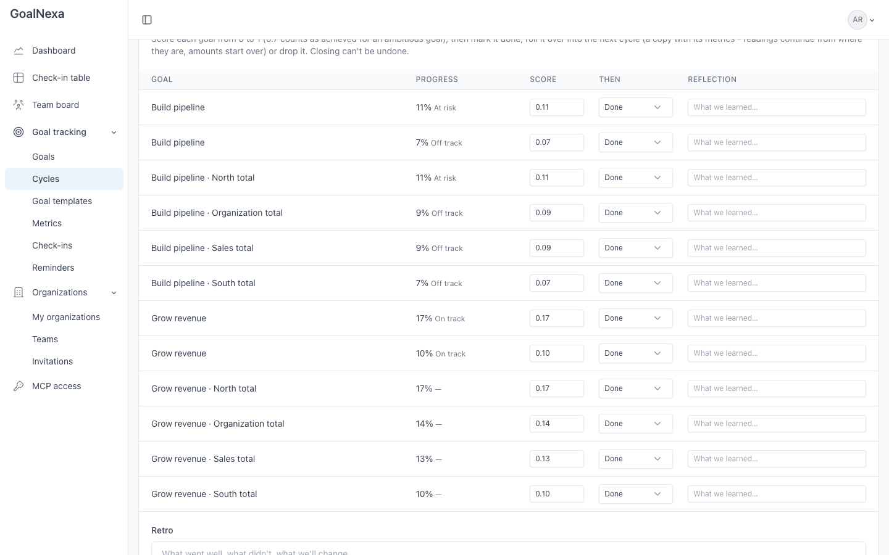

After closing, the cycle shows a **Scorecard**: average score and how
many goals were *Achieved* (>= 0.7), *Partial* (>= 0.3), *Missed* or
*Dropped*. A closed cycle is read-only.


# 9. Teams and the team board

For organizations where several teams run **the same goals** (each
sales region, each store, each squad): define the goals once as a
**goal template**, give each team its own copy with its own targets,
and let GoalNexa add up the totals.

> Creating teams and templates needs the **Owner** or **Admin** role in
> the organization.

## 9.1 Create teams

1. **Organizations > Teams** → **+ New team**.
2. Enter the **Name**, the **Organization** and, for a sub-team, its
   **Parent** (e.g. *North* under *Sales*). Click **Create**.
3. Open the team → **Team members** → **Add someone from the
   organization**, choose **Lead** (sets the team's targets) or
   **Member** (checks in) → **Add**.

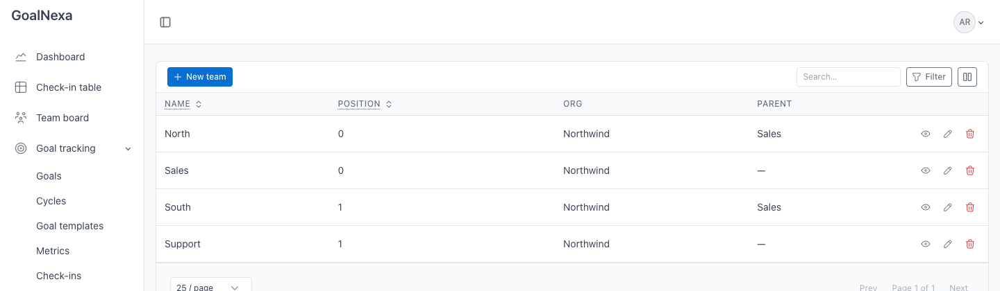

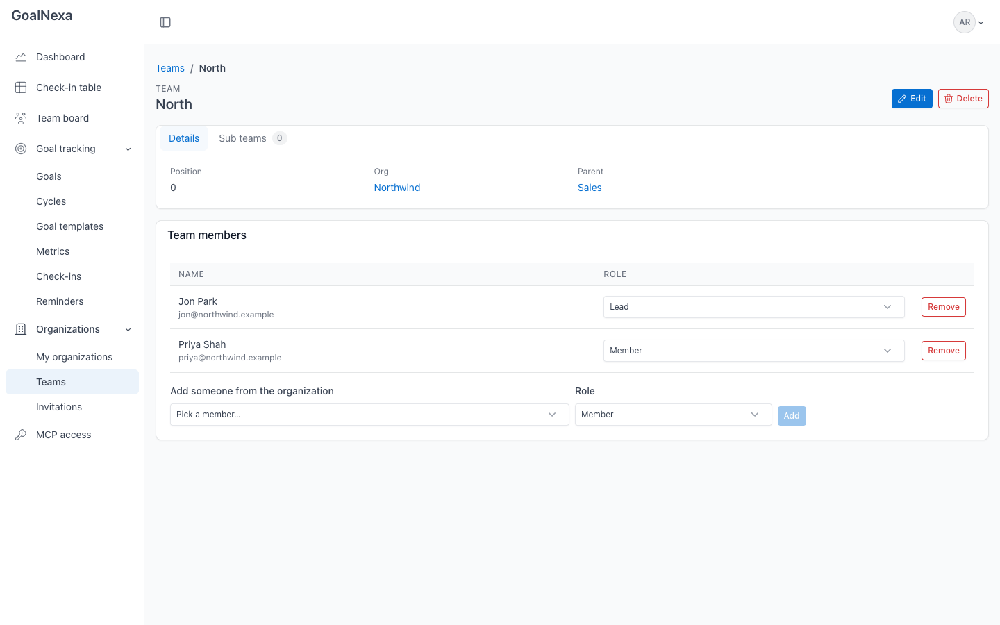

## 9.2 Create a goal template

1. Open **Team board** and click **+ New** next to *Goal template* (or
   **Create the first one**).
2. **Template** - a **Name** ("Sales targets") and description → **Next**.

   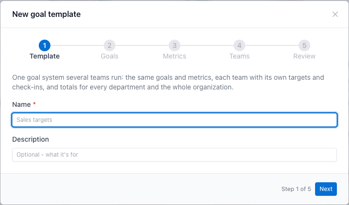{width=70%}

3. **Goals** - the **Main goal** ("Grow revenue") and any sub-goals ->
   **Next**.
4. **Metrics** - for each goal, its metrics:

   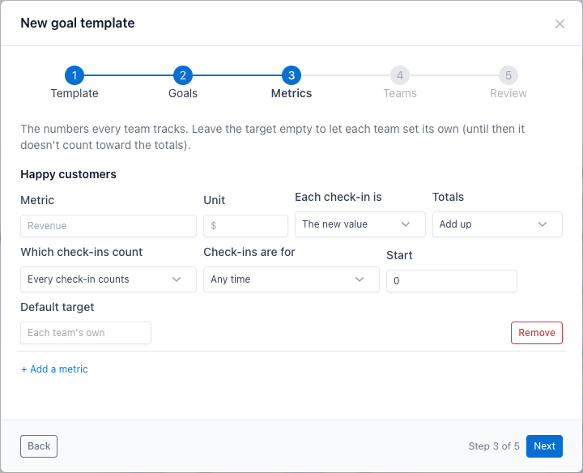{width=75%}

   - **Metric**, **Unit**.
   - **Each check-in is** - the new value, or an amount to add.
   - **Totals** - how teams add up: *Add up*, *Average*, *Lowest team*
     or *No total*.
   - **Target is for**, **Counts**, **Progress is**, **Which check-ins
     count**, **Check-ins are for** - for quotas (4.5).
   - **Start** and **Default target** - leave the target empty to let
     each team set its own.
5. **Teams** - pick the **Cycle** and tick the teams that run it.
6. **Review** → **Create the template**.

The template has its own page under **Goal tracking > Goal templates**.
A change there reaches every team's copy.

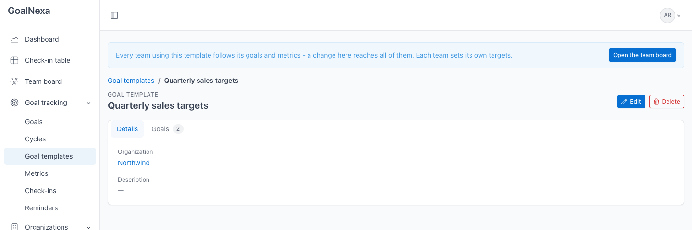

## 9.3 The team board

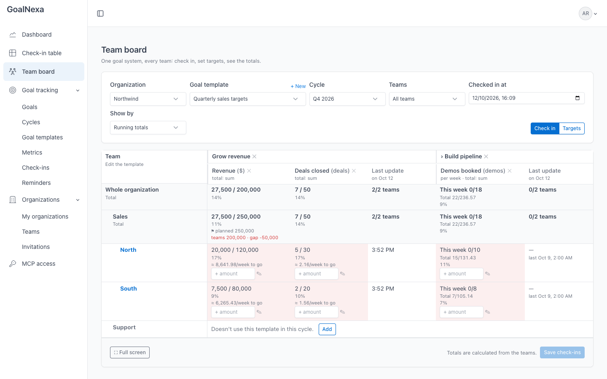

Pick **Organization**, **Goal template**, **Cycle** and **Teams** at the
top. Rows are the teams in their tree; columns are the template's
metrics.

- **Whole organization** and each department ticked in Targets show
  **totals**, calculated from the teams below (read-only), with the
  planned target and the gap.
- Each team's cell shows current / target, %, and the pace needed
  ("≈ 2.16/week to go"). Cell colors go from red (behind) to green.
- **Last update** shows when each team last checked in.
- Only teams that run the template are shown; a line above the board
  counts the others (**Add them in Targets**).

### Set targets

1. Click **Targets** (top right).
2. Type each team's **Start** and **Target**; on a total row, a
   **Planned** top-down target.
3. Two tick columns follow the team names. **Own**: the team runs the
   template, with its own targets and check-ins - tick to add it, untick
   to take it out (a team with check-ins keeps them as its own goals); a
   department with its own targets keeps them on its own row, with its
   total (if ticked) as a line under each cell. **Total**: the
   department, or **Whole organization**, adds up the teams below it -
   only ticked totals are calculated. A team with no teams below has no
   Total.
4. Click **Save targets**.

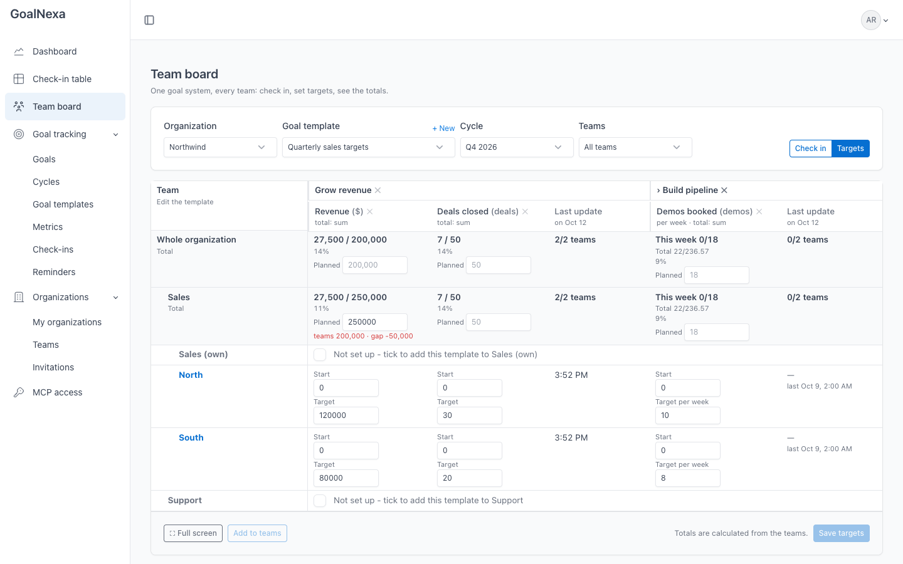

### Check in for every team

1. Click **Check in**. Set **Checked in at** if it isn't now.
2. Type each team's number in its cell (Enter moves down); **✎** adds a
   note.
3. Click **Save N check-ins** (**Discard** drops the changes).

**Show by** (Week, Month...) shows each period's numbers instead of the
running totals - good for "how did each region do this week".

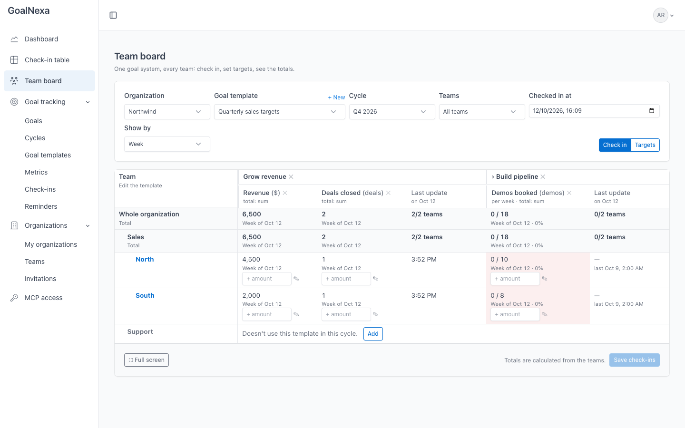

**Full screen** shows the board alone, for a team meeting; **Exit full
screen** (or Esc) returns.

Owners and admins can click a goal or metric header to edit it, or **✕**
to remove it from the template (a team copy with check-ins is kept as
that team's own).


# 10. Sharing a dashboard

Give stakeholders a live, read-only view without an account.

1. On the dashboard, show the goals you want to share (eyes) and untick
   metrics you want to leave out.
2. Click **Share** (Filters header).
3. Give the link a **Name** and click **Create link**.

   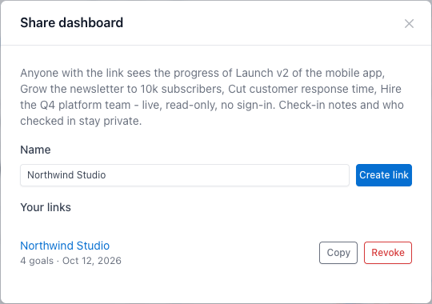{width=60%}

4. Click **Copy** and send the link.

   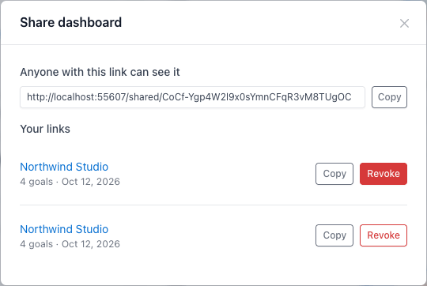{width=60%}

Anyone with the link sees the goals and charts, live:

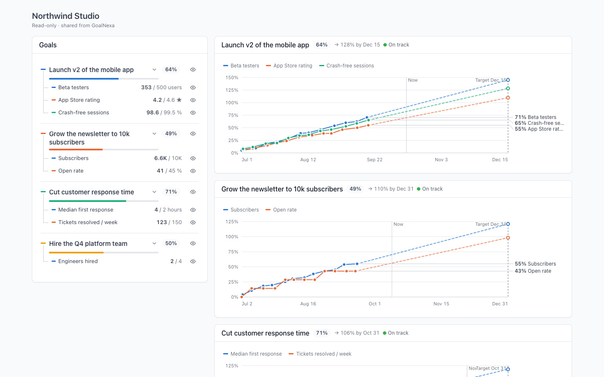

- Notes and who checked in are not shown.
- The link only ever shows what *you* can still see.
- **Your links** in the same dialog lists every link: **Copy** again or
  **Revoke** to end it.


# 11. AI assistants (MCP)

Connect Claude, ChatGPT, Gemini, Cursor, VS Code, Claude Code and others
to GoalNexa. The assistant can do exactly what you can - nothing more.

## 11.1 Connect an app

1. Open **MCP access** in the sidebar.

   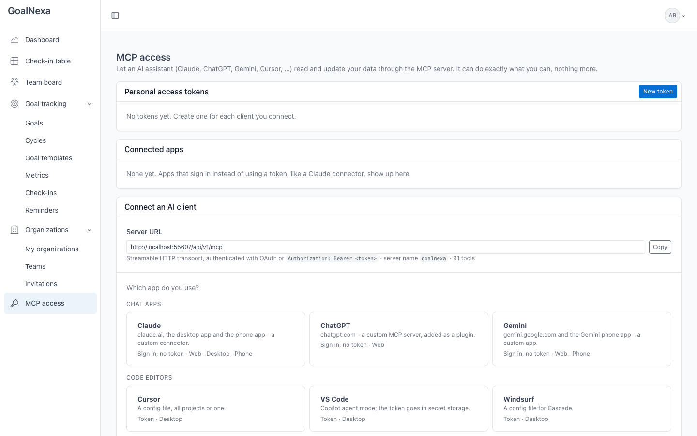

2. Under **Which app do you use?** click your app. Its steps appear,
   with the **Server URL** (and **Copy**) and screenshots of the app.

   

3. Apps marked **Sign in, no token** (Claude, ChatGPT, Gemini): add
   GoalNexa as a custom connector with the URL; the app opens GoalNexa,
   you sign in and click **Allow**.
4. Apps marked **Token** (Cursor, VS Code, Claude Code, Codex...): click
   **Create a token** in the steps - the snippet is filled in. Copy it
   now: a token is shown only once.
5. Wait for **Connected**; try one of the suggested prompts.

Assistants that sign in appear under **Connected apps** (**Disconnect**
to remove one).

## 11.2 Personal access tokens

1. **New token** → a **Name** ("Claude Code on my laptop") and
   **Expires after** (30 days, 90 days, 1 year, never) → **Create
   token**.
2. Copy the token immediately.
3. **Revoke** stops a token at once.

{width=50%}

## 11.3 Install the skills

For assistants that support skills (Claude Code, Codex...), copy the
prompt under **Agent skills** - "Install the goalnexa skills from
\<your address\>/api/v1/mcp/skills" - into the assistant. It learns to plan
goals, check in and run reviews. Run the same prompt again to update.

## 11.4 What to say

| You say | The assistant |
|---|---|
| "Plan a half marathon in November." | Drafts a goal with metrics, asks, then creates it |
| "Ran 12 km today." | Finds the metric, checks in 12, replies with progress and a dashboard link |
| "We're at 420 beta users." | Checks in the new reading |
| "How are my goals doing?" | Reviews progress, pace and risks |
| "Remind me weekly on Telegram." | Sets up reminders |

Check-ins made by an assistant are marked *AI agent* in the activity
feed and chart tooltips.


# 12. Automatic check-ins

Send numbers from a script, a cron job, Home Assistant, n8n, Zapier or a
webhook, without signing in.

1. Open the metric (click its name, or **Goal tracking > Metrics**).
2. In **Automatic check-ins** click **Create token**.

   

3. Copy the token and the example right away - they're shown only once.
4. Have the other system send a POST with the value:

   ```
   curl -X POST https://<your address>/api/v1/metrics/<id>/ingest \
     -H "Authorization: Bearer gnm_..." \
     -H "Content-Type: application/json" \
     -d '{"value": 42}'
   ```

   Optional fields: `note`, `checked_in_at` (ISO 8601). A sender that
   can't set headers may add `?token=...` to the URL.
5. **Rotate token** replaces it; **Revoke** turns it off.

The token can only add check-ins to this one metric. They appear with
the source *Ingest URL*.


# 13. Your account

## 13.1 My account

User menu → **My account**.


- **Download my data** - a JSON file with your goals, metrics,
  check-ins, cycles, comments, organizations, sign-ins and AI access.
- **Change password** - current password, new one twice → **Change
  password**. Every other session is signed out.
- **Delete my account** - your password, tick "I understand this can't be
  undone." → **Delete my account**. Your goals, personal cycles and
  comments are deleted; organizations where you're the only member are
  deleted; in others the longest-standing admin becomes owner.

## 13.2 Email preferences

User menu → **Email preferences**. Switch each category on or off -
changes save immediately:

- **Reminders & digest**
- **Tips & getting started**
- **Progress & milestones**


Account emails (address confirmation, password reset, security notices)
are always sent. Every other email has an unsubscribe link at the
bottom.


# 14. Administration (system console)

Administrators open **System console** from the user menu. It has its
own sidebar and a **Back to GoalNexa** link.

## 14.1 Status


Background jobs (the scheduler that sends reminders and digests must say
*Running*), email and notification deliveries in the last 24 hours, and
usage numbers (users, organizations, goals, check-ins by source).

## 14.2 Settings


Each setting has **Save** and **Reset to default**. A setting marked
**Set by \<ENV\>** comes from the server's environment and is locked.
Main groups:

- **Accounts** - who can sign up (anyone / invitation only / closed),
  allowed email domains, email verification, password length, common
  password check, lockout after failed sign-ins, password login on/off
  (with single sign-on).
- **Limits** - members and goals per organization.
- **Announcement** - a banner for every user.
- **Data retention** - how long logs are kept.
- **Test email** - send yourself a test message.

Server items (database, email server, secret keys) are shown read-only.

## 14.3 Users


- **Invite user** - creates the account and gives you a set-password
  link to send.
- Open a user to **Disable account** / **Enable account**, **Unlock**,
  **Create password link**, **View as** (a read-only view of what they
  see, for 15 minutes), **Export data**, see **Where they're signed in**
  and **Sign out everywhere**, or delete the account.


The last administrator cannot be disabled, deleted or lose that role.

## 14.4 Roles and access control

**Access control > Users / Roles** - roles (*Admin*, *Member* ...),
app-wide or per organization, and what each may do. Members can't open
the console.

## 14.5 Other pages

| Page | Use it to |
|---|---|
| **Insights** | Active users, activation, adoption over N days; **Export CSV** |
| **All organizations** | Every organization: members, transfer owner, per-org limits, delete |
| **Audit log** | Sign-ins (and failures), user, role, settings and org changes, view-as |
| **Email log** / **Notification log** | What was sent, and failures |
| **Lifecycle email** | Onboarding and tip emails: stats, preview, send a test |
| **Suppressed addresses** | Addresses that bounced or complained (no more mail) |


# Appendix A. Field reference

## Goal

| Field | Meaning |
|---|---|
| Title | What you want to achieve, as an outcome |
| Description | Why it matters |
| Organization | Empty = personal (only you) |
| Status | Not started / In progress / Completed / Archived (hidden from the dashboard) |
| Target date | Progress is projected to this date |
| Visibility | Public (organization) / Private (owner + members) / Team (its team and the teams under it, plus org owners/admins) |
| Team | The team the goal is for |
| Cycle | The period it's set for |
| Parent | Makes it a sub-goal |
| Progress, Projected progress, Health | Calculated |

## Metric

| Field | Meaning |
|---|---|
| Name, Description, Unit | What you measure |
| Base value | Start; progress is measured from it |
| Target value | Where you want to be; lower than base = should go down; equal = tracked only |
| Current value | Updated by check-ins |
| Each check-in is | The new value (reading) / An amount to add (sum) |
| Check in every | No schedule / Daily / Weekly / Monthly - reminders |
| Target is for | The whole goal / Each day, week, month, quarter, year (quota) |
| Count days | Every day / Weekdays only |
| Progress by | Total against every period's target / How often the target is hit |
| One reading per | Every check-in counts / The last one each period |
| Check-ins are for | Any time / A day, week, month, quarter, year |
| Parent | Makes it a sub-metric (not counted in the goal's progress) |

## Check-in

| Field | Meaning |
|---|---|
| Value | The new reading, or for a sum metric the amount to add |
| Note | Optional |
| Checked in at | When the reading was taken; blank = now |
| Source | Web / AI agent / Ingest URL / Team total |

## Cycle

| Field | Meaning |
|---|---|
| Name, Organization | "Q4 2026"; empty organization = personal |
| Starts on, Ends on | The period |
| Status | Planning / Active / Closed |
| Retro | What went well and what to change |

# Appendix B. Glossary

| Term | Meaning |
|---|---|
| **Goal** | An outcome you want, measured by metrics |
| **Metric** | One number from a start to a target |
| **Check-in** | A recorded value of a metric at a time |
| **Reading / Sum** | A check-in that replaces the value / adds to it |
| **Tracked only** | A metric with target = start: values, no % |
| **Prediction** | Each metric's trend carried to the target date |
| **Health** | On track / At risk / Off track / Achieved |
| **Cycle** | A period such as a quarter, closed with scores |
| **Organization** | A group whose members share goals |
| **Team** | A group inside an organization, can be nested |
| **Goal template** | One set of goals and metrics run by several teams |
| **Total** | A team-board row calculated from its teams |
| **Quota** | A target per day / week / month... |
| **MCP** | The protocol AI assistants use to connect to GoalNexa |

# Appendix C. Troubleshooting

| Problem | What to do |
|---|---|
| "Sign-ups are by invitation only" | Use the invitation link; ask an organization owner for one |
| Account locked | Wait a few minutes, use **Forgot password?**, or ask an administrator to **Unlock** |
| No confirmation email | **Send it again**; check spam; ask your administrator whether email is set up |
| An invitation says it was sent to another email | Sign out and sign in (or sign up) with the invited email |
| A goal disappeared from the dashboard | It may be archived, in another cycle or team filter, or hidden (eye). **Show all** |
| Can't show more goals | Up to 8 at a time - hide one first |
| No health badge | Give the goal a target date and at least two check-ins |
| No reminders arrive | Metric needs **Check in every**; **Reminders** must be on with a destination; **Send a test**; the administrator's Status page must show the scheduler *Running* |
| The assistant doesn't see GoalNexa | Check **Connected apps** / tokens on **MCP access**; a Claude/ChatGPT connector needs a public HTTPS address |
| A team-board total won't take a check-in | Totals are calculated; check in on a team's row |
